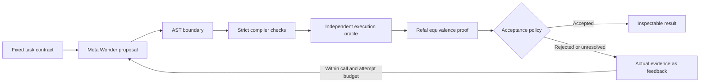

# Architecture and evidence contract

The Rust library contains contracts, evidence, verifier, worker transport, Meta
provider and HTTP application. React displays evidence; it cannot assign proof
verdicts or change acceptance rules.

## Candidate boundary

JSON conformance does not establish correctness. Before assembling Refal, IACA
lexes the expression, rejects definition/condition/directive tokens, checks
balanced nesting, parses the AST, and validates every term.

The boundary permits at most 1,024 bytes, 96 syntax nodes and 12 nesting levels.
A result is one bracketed data expression or an `Append` call whose two
arguments are themselves list-valued expressions. Literal brackets cannot
contain executable calls. Variables come from the fixed pattern. The helper
terminates on finite lists; models cannot introduce recursion or invoke I/O.

The assembled reference and helpers stay fixed. Strict diagnostics come from
typed engine APIs. Execution uses typed Refal values, avoiding command-line
argument/bracket ambiguities. A separate Rust concatenation oracle checks both
the reference and candidate on every combination of six samples: empty, atomic,
multi-element, empty bracket, nested brackets, and mixed symbols/numbers.

Equivalence aligns `Reference` and `Candidate` on the same pattern. Acceptance
requires a `Proved` result, completion inside budget and nonempty closed branches,
plus every other gate. Open, incomplete or unavailable proof results cannot
authorize a change. A witnessed execution failure rejects even when symbolic
checking cannot finish.

The engine is a research implementation, not an independently certified proof
checker. Predicate-proof mode is outside this application's trusted path.

## Resources and credits

Each verification starts the same binary as a worker with a cleared environment
and JSON over stdin. No shell interprets model output. Only `SystemRoot` is
preserved on Windows. The parent limits each output stream to 64 KiB and kills
the child after eight seconds or when its future is dropped.

One run is active at a time, with at most two attempts. Live calls default to
zero, with a configurable process allowance capped at two. Each call is reserved
atomically before sending. Requests are limited to 12 KB and 0.002048M completion
tokens, time out after 55 seconds, follow no redirects and are never automatically
retried. Cancellation prevents subsequent calls; an in-flight call can still be
billed. API errors expose status, not raw response bodies or credentials.

The endpoint and model are fixed in source. Cost estimates use reported usage
and the published uncached rates; they are not a billing ledger.

## Evidence

A SHA-256 fingerprint identifies the versioned task, reference, helpers and
pinned engine. Each attempt records that fingerprint, candidate, provenance,
diagnostics, concrete results, proof leaves, budgets, timings, usage and exact
feedback. The UI distinguishes fixtures, manual candidates and live Meta results.
Fixture repair is scripted. Reduction counts measure the concrete suite, not
universal wall-clock speedup.

Finished runs are written atomically to ignored `runs/`. The server exposes the
most recent 24 matching-contract runs. Reopening history invokes no model.
JSON export contains the full contract and run. Public demonstration evidence,
when included, is deliberately selected separately.

The local service binds to loopback, rejects cross-origin state-changing browser
requests, limits request bodies, and serves a restrictive content security policy.
Use SSH forwarding for access from another machine.
